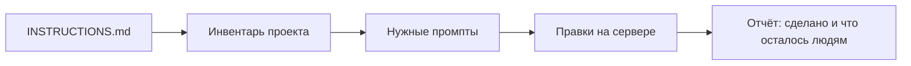

# harden-prompts

Репозиторий: [github.com/RomanAlmaz/harden-prompts](https://github.com/RomanAlmaz/harden-prompts)

Это набор заданий для ИИ. Ты открываешь свой сайт или приложение в чате и отдаёшь ИИ эти файлы. ИИ читает код и закрывает дыры: пароль, вход, оплата, чужие заказы, файлы, ключи.

88 заданий · 12 тем · лицензия [MIT](LICENSE)

## Что ты получаешь

- ИИ правит **твой** проект. Сам по себе этот репозиторий приложение не защищает: защищается тот код, который открыт рядом с инструкциями.
- Готовый текст на каждую тему. Можно отдать все файлы сразу или один, например только оплату.
- ИИ пропускает темы, которых в проекте нет. Магазину без нейросети файл про модели не нужен.
- В конце список: что уже закрыто в коде и что осталось человеку. Сертификат, боевые ключи и облако из репозитория не настраиваются.
- Понятная граница: в файлах написано, какую дыру закрыть. Шагов взлома и примеров для атаки нет.

ИИ начинает с [`INSTRUCTIONS.md`](INSTRUCTIONS.md). Человеку для одной функции достаточно файла из каталога ниже.

## Как пользоваться

**Весь проект.** Открой свой код в чате с ИИ. Приложи [`INSTRUCTIONS.md`](INSTRUCTIONS.md) и эту папку, либо дай ссылку на репозиторий и напиши: «прочитай INSTRUCTIONS.md из harden-prompts и примени к этому проекту».

**Одна функция.** Отдай один файл. Оплата магазина - [`03-payments/checkout.md`](03-payments/checkout.md). Вход - [`01-authentication/login.md`](01-authentication/login.md). Регистрация - [`01-authentication/registration.md`](01-authentication/registration.md).

В каждом промпте одно и то же устройство:

| Блок | Зачем |
| --- | --- |
| Поля сверху | ИИ решает, относится ли файл к проекту |
| Уязвимости | Что сломается, если контроль не стоит |
| Сделать | Конкретные меры, без шагов атаки |
| Промпт | Текст, который можно вставить отдельно |
| Готово, когда | Проверка, что меру не сделали наполовину |

Приоритет в поле `priority`: `critical` закрывать раньше `high`, `high` раньше `medium`.

## Каталог

### Вход

Пароль, регистрация, второй фактор, чужой провайдер.

| Файл | О чём |
| --- | --- |
| [Вход в аккаунт](01-authentication/login.md) | TLS, одна и та же ошибка, лимит попыток, новая сессия |
| [Регистрация](01-authentication/registration.md) | Роль не из браузера, подтверждение контакта, боты |
| [Хранение паролей](01-authentication/password-storage.md) | Argon2id и запасные алгоритмы, соль, старые хеши |
| [Сброс пароля](01-authentication/password-reset.md) | Одноразовый токен, одинаковый ответ, гашение сессий |
| [Второй фактор](01-authentication/mfa.md) | Флаг MFA только на сервере, TOTP и запасные коды |
| [Passkeys](01-authentication/passkeys.md) | WebAuthn: challenge, origin, счётчик подписи |
| [Утёкшие пароли](01-authentication/credential-stuffing.md) | Лимит на учётку, блоклист, MFA на админку |
| [OAuth и OpenID](01-authentication/oauth-oidc.md) | Код и PKCE, точный redirect, связка `iss` + `sub` |
| [SAML](01-authentication/saml.md) | Подпись утверждения, адресат, одноразовый запрос входа |

### Сессия

| Файл | О чём |
| --- | --- |
| [Cookie и сессия](02-session/session.md) | Случайный id, `Secure` / `HttpOnly` / `SameSite`, сроки |
| [JWT](02-session/jwt.md) | Алгоритм с сервера, короткий access, отзыв refresh |
| [Выход](02-session/logout.md) | Сервер забывает пропуск, «выйти везде» |

### Оплата

| Файл | О чём |
| --- | --- |
| [Корзина и заказ](03-payments/checkout.md) | Цена только с сервера, редирект не равен оплате |
| [Шлюз](03-payments/payment-gateway.md) | Секрет не в браузере, сверка суммы и id |
| [Вебхуки](03-payments/webhooks.md) | Подпись сырого тела, идемпотентная отгрузка |
| [Дорогая операция](03-payments/step-up-authorization.md) | Подтверждение конкретной суммы и получателя |
| [Данные карты](03-payments/cardholder-data.md) | Не хранить CVV и PAN, не писать их в лог |

### Канал и браузер

| Файл | О чём |
| --- | --- |
| [HTTPS и TLS](04-transport/tls.md) | Шифрование канала, HSTS, проверка сертификата |
| [Заголовки](04-transport/security-headers.md) | iframe, тип ответа, referrer, кэш личных страниц |
| [CSP](04-transport/csp.md) | Откуда страница имеет право брать скрипты |
| [CORS](04-transport/cors.md) | Чужой сайт не читает ответ с cookie |
| [Чужие скрипты](04-transport/third-party-scripts.md) | Аналитика и теги не стоят на странице пароля |
| [Чужой фрейм](04-transport/clickjacking.md) | Запрет вложения страниц входа и оплаты |
| [Кэш](04-transport/web-cache.md) | Личный ответ не запоминается общим кэшем |
| [Привязка сертификата](04-transport/pinning.md) | Без HPKP в браузере и без отключения проверки |
| [Брошенный DNS](04-transport/subdomain-takeover.md) | Запись не указывает на удалённый ресурс |
| [Глобальные имена страницы](04-transport/dom-clobbering.md) | Конфиг не читается из id элемента |
| [Сообщения окон](04-transport/postmessage.md) | Проверка origin у `postMessage` |
| [Утечки состояния](04-transport/xs-leaks.md) | Изоляция окон там, где продукт это позволяет |

### Права

| Файл | О чём |
| --- | --- |
| [Авторизация](05-access-control/authorization.md) | Право на действие проверяет сервер, отказ по умолчанию |
| [Чужой объект](05-access-control/idor.md) | Id без проверки владельца |
| [Чужой сайт и cookie](05-access-control/csrf.md) | Состояние не меняется чужой страницей |
| [Организации](05-access-control/multi-tenant.md) | Данные одного клиента не видны другому |
| [Админка](05-access-control/privileged-actions.md) | MFA, журнал, отдельные опасные действия |

### Ввод

| Файл | О чём |
| --- | --- |
| [Проверка данных](06-input/validation.md) | Схема на сервере, лимит размера, лишние поля |
| [SQL](06-input/sql-injection.md) | Параметры запроса, белый список сортировки |
| [Вывод в HTML](06-input/xss.md) | Экранирование по контексту, санитайзер богатого текста |
| [Команды ОС](06-input/command-injection.md) | Список аргументов вместо оболочки |
| [Чужой URL](06-input/ssrf.md) | Сервер не ходит во внутреннюю сеть по ссылке пользователя |
| [Разбор объектов](06-input/deserialization.md) | Не восстанавливать исполняемые объекты из ввода |
| [Пути](06-input/path-traversal.md) | Id файла вместо пути, архивы внутри каталога |
| [Лишние поля](06-input/mass-assignment.md) | Роль и баланс не приходят в профиле |
| [Редирект](06-input/open-redirect.md) | Возврат после входа остаётся на нашем хосте |
| [NoSQL, LDAP, прототип](06-input/nosql-ldap-prototype.md) | Операторы запроса и ключи прототипа не из JSON клиента |
| [Шаблоны](06-input/ssti.md) | Строка человека не становится шаблоном сервера |
| [XML](06-input/xxe.md) | Внешние сущности и DTD выключены |
| [XPath](06-input/xpath.md) | Выражение не склеивается из ввода |
| [Заголовки писем](06-input/email-header.md) | Перевод строки в теме и адресе отклоняется |

### Файлы

| Файл | О чём |
| --- | --- |
| [Загрузка](07-files/upload.md) | Тип по содержимому, каталог не исполняется |
| [Скачивание](07-files/download.md) | Право на объект, браузер не угадывает тип |

### API

| Файл | О чём |
| --- | --- |
| [HTTP API](08-api/rest.md) | Маршруты, пагинация, отладочная консоль |
| [GraphQL](08-api/graphql.md) | Права в резолвере, лимит глубины |
| [WebSocket](08-api/websocket.md) | Origin, подписка на комнату, токен не в URL |
| [Частота](08-api/rate-limit.md) | Лимит входа, кодов и платных вызовов |
| [gRPC](08-api/grpc.md) | TLS, право не из тела, лимит сообщения |
| [Граница HTTP](08-api/http-messages.md) | Противоречивая длина запроса отклоняется |

### Данные

| Файл | О чём |
| --- | --- |
| [Секреты](09-data/secrets.md) | Ключи вне git, отзыв уже утёкших |
| [Шифрование](09-data/encryption.md) | Штатный AEAD, ключ отдельно от данных |
| [Личные данные](09-data/privacy.md) | Меньше полей в API и логах |
| [Журналы](09-data/logging.md) | След опасных действий без паролей |
| [Ошибки](09-data/errors.md) | Наружу код и id, стек остаётся в логе |
| [Ключи](09-data/key-management.md) | Ключ отдельно от данных, отдельный на задачу |
| [Случайность](09-data/randomness.md) | Секреты только из CSPRNG |
| [Сбой проверки](09-data/exceptional-conditions.md) | Ошибка права и платежа останавливает действие |

### Правила продукта

| Файл | О чём |
| --- | --- |
| [Скидки, остатки, статусы](10-business/business-logic.md) | Сервер считает деньги и не прыгает через статусы |
| [Почта и телефон](10-business/email-verification.md) | Одноразовый код, смена ящика |
| [Боты](10-business/anti-automation.md) | Лимит массовых действий, капча на сервере |
| [Гонки запросов](10-business/race-conditions.md) | Списание остатка одним атомарным шагом |
| [Модель угроз](10-business/threat-modeling.md) | Какие отказы сервер обязан дать новой функции |

### Зависимости и поставка

| Файл | О чём |
| --- | --- |
| [Библиотеки](11-supply-and-infra/dependencies.md) | Lock-файл и обновления без отключения аудита |
| [CI](11-supply-and-infra/cicd.md) | Секреты прода не видны форку |
| [Контейнеры](11-supply-and-infra/containers.md) | Образ без секретов и без root по привычке |
| [Настройки прода](11-supply-and-infra/misconfiguration.md) | Без отладки, паролей-примеров и лишних модулей |
| [База](11-supply-and-infra/database.md) | Учётка без прав владельца, порт не в интернет |
| [Сервисы](11-supply-and-infra/microservices.md) | Соседний сервис доказывает, кто он |
| [Функции по событию](11-supply-and-infra/serverless.md) | Узкая роль, событие как недоверенный вход |
| [Облако](11-supply-and-infra/cloud.md) | Закрытые бакеты и короткие права |
| [Мобильный клиент](11-supply-and-infra/mobile.md) | Серверный секрет не зашит в приложение |
| [Состав сборки](11-supply-and-infra/sbom.md) | Список компонентов рядом с релизом |
| [Сеть](11-supply-and-infra/network.md) | Снаружи только нужные порты |
| [Фреймворки](11-supply-and-infra/frameworks.md) | Не выключать штатную защиту языка и фреймворка |
| [Сообщения о дырах](11-supply-and-infra/vulnerability-disclosure.md) | Контакт для отчёта без сбора паролей |
| [Старый код](11-supply-and-infra/legacy.md) | Фильтр на периметре не называется исправлением |
| [Расширение браузера](11-supply-and-infra/browser-extensions.md) | Минимальные права и проверка сообщений |
| [Несколько фронтендов](11-supply-and-infra/micro-frontends.md) | Общий скриптовый токен не раздаётся фрагментам |

### Модели

| Файл | О чём |
| --- | --- |
| [Текст в модель](12-ai/prompt-injection.md) | Ввод пользователя не приказ и не обход прав |
| [Документы и агенты](12-ai/rag-and-agents.md) | Поиск с фильтром прав, узкий список инструментов |
| [Файлы моделей](12-ai/model-ops.md) | Недоверенный файл модели не исполняется при загрузке |

## Чего эти файлы не обещают

Репозиторий хранит задания для ИИ. Он не выдаёт сертификат PCI DSS, OWASP ASVS, ISO и не заменяет юриста по персональным данным. После правок остаётся отчёт, а не печать «проект безопасен».

Цифры для Argon2id взяты из OWASP Password Storage Cheat Sheet на момент сборки. Перед внедрением открой актуальную страницу: параметры со временем поднимают.

Тексты заданий написаны заново. Стандарты по ссылкам не скопированы.

Отдельного файла нет у отраслевых тем: авто, дроны, санкционный скоринг, рекламные модели. Нет каталога обхода фильтров. Языковые шпаргалки Django, .NET, Java, Laravel, Next.js, Node.js, PHP, Rails, Symfony и FastAPI собраны в [фреймворках](11-supply-and-infra/frameworks.md), чтобы не расходиться с общими правилами. Куки, HSTS, боты, параметризация запросов и секреты npm закрыты файлами сессии, TLS, лимитов и зависимостей.

## Опора

- [OWASP ASVS 5.0](https://owasp.org/www-project-application-security-verification-standard/)
- [OWASP Cheat Sheet Series](https://cheatsheetseries.owasp.org/)
- [NIST SP 800-63B](https://pages.nist.gov/800-63-4/sp800-63b.html) - пароли и факторы входа

## Лицензия

[MIT](LICENSE). Файлы можно читать, копировать, менять и встраивать в свои проекты, в том числе коммерческие. В копиях сохраняется текст лицензии.

## Новый промпт

Один файл - один класс угроз. Имя папки по теме, имя файла по делу. Сверху те же поля, что у соседних файлов: `id`, `title`, `topic`, `priority`, `applies_when`. Внутри таблица угроз, меры, готовый промпт и ссылка на первоисточник. Без шагов атаки.
